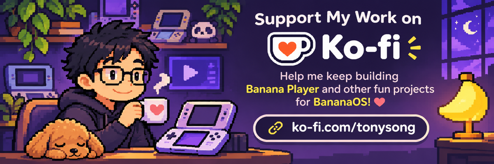

# BananaOS app dev guide

A guide and a starter app for writing native apps for [BananaOS](https://github.com/JorreFog/BananaLinux) on the
Anbernic **RG DS / RG DS Plus** (RK3568, aarch64, two 4:3 panels, the bottom one touch, about 1 GB of RAM, no swap).

Everything here was learned building [Banana Player](https://github.com/tonywei92/banana-player), a media player that
runs on these handhelds, and checked on the device. Each rule comes with its reason, so you can tell when it applies to
your app.

**Start with the guide: [BANANAOS-APP-GUIDE.md](BANANAOS-APP-GUIDE.md).**

## What the guide covers

- How apps launch (Port vs Store app), the two panels, input (the Nintendo layout, F, L2/R2, L3) and touch
- Lid and sleep, and keeping your app running with the lid shut
- Volume, brightness, the bottom backlight, battery and sound: the only interfaces BananaOS allows
- What to bundle and what to take from the system; fonts; the GPU; software-only decoding
- SDL2 and how to keep it cheap (an idle loop, redraw on change, cached text)
- Running Java or another big helper process (OpenJ9, memory, start time)
- Building for aarch64 in Docker (cached), crash logs, pushing to the handheld over SSH, publishing to the Store
- Best practices and pitfalls learned the hard way

## The starter

A small C++17 + SDL2 app that already follows the guide: both panels drawn and redrawn after start and wake, button
mapping, evdev touch on the bottom panel, pause on lid and wake, the lid-sleep guard, volume/brightness/backlight
helpers, a log file, and a helper for a child process.

```sh
# on a computer (macOS: brew install sdl2 sdl2_ttf cmake pkg-config); two windows stand in for the two panels
cmake -S . -B build && cmake --build build -j
./build/app-test          # the tests
./build/my-app            # run it

packaging/build-bundle.sh            # the aarch64 bundle (Docker, cached; --quick skips the zip, --clean starts over)
tools/push-handheld.sh root@<handheld-ip>    # copy the changed files over SSH, quit the app cleanly, swap the folder
```

| Path | What |
|---|---|
| `src/` | The app: `main.cpp` (windows, loop), `input`, `touch`, `sleepwatch` (lid/wake), `lidsleep` (keep running with the lid shut), `levels` (volume, brightness, backlight, battery), `child` (a helper process), `applog` |
| `tests/` | Tests for the pure parts |
| `packaging/` | `launch.sh` (Store app), `port.sh` (Port), `build-bundle.sh`, the Store catalog entry and icon |
| `tools/` | `push-handheld.sh` |
| `assets/fonts/` | Inter (SIL Open Font License); BananaOS has no fonts of its own |

## Status

It builds and its tests pass on macOS and in an arm64 Linux container, and the bundle builds. These are not yet
checked on a real handheld: the two SDL renderers on KMSDRM at once, the touch device path on the RG DS Plus, the lid
and lid-sleep handling, the volume/brightness writes, and launching as a Port and as a Store app. Reports and fixes
are welcome.

## Licence

The guide and the starter are under the [MIT License](LICENSE): copy the starter into your own app freely. The bundled
Inter font is under the SIL Open Font License ([assets/fonts/Inter-LICENSE.txt](assets/fonts/Inter-LICENSE.txt)).

## Support

<p align="center">
  <a href="https://ko-fi.com/tonysong"></a>
</p>

This guide is free and always will be. If it helped you ship an app for your handheld and you'd like to say thanks:
☕ [buy me a coffee on Ko-fi](https://ko-fi.com/tonysong). Entirely optional. ❤️
